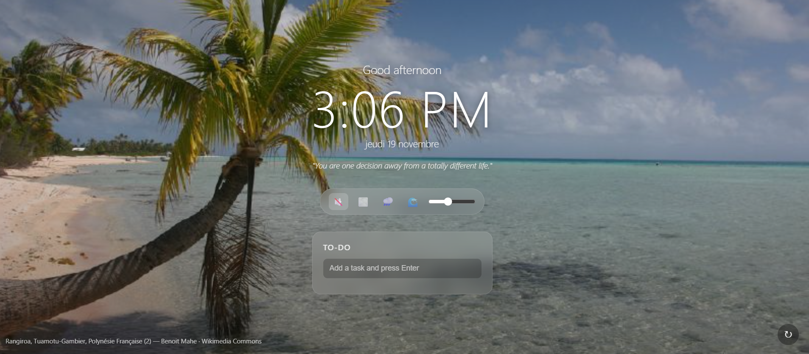

# Focus Tab (Momentum Dash replica)

## 1. Purpose
Focus Tab is my version of the Momentum Dash browser extension for Chrome. It replaces the new-tab page with a calm dashboard: a photo of French Polynesia, a clock with a greeting, a motivational quote, a to-do list, and ambient sounds (white noise, rain, ocean waves).

## 2. Data collection
- Photos come from the public Wikimedia Commons API. No account or API key is needed. The extension searches for French Polynesia places (Bora Bora, Moorea, Tahiti...) and picks one photo at random.
- Quotes: a fixed list of generic motivational sayings stored in the code (script.js). They were provided by the AI assistant while building the extension, not written by me and not loaded from a website. No specific source or author is credited.
- The time and date come from the computer.
- The sounds are generated in the browser, so no audio files are downloaded.
- The to-do tasks are typed by the user.

## 3. Data persistence
Everything is saved in the browser with chrome.storage.local. There is no server and no database. It stores the to-do list (so tasks stay after closing the browser), the last photo, and the chosen sound and volume. The data stays on the user's computer and is not sent anywhere.

## 4. User interaction
Open a new tab and the dashboard appears. Click the arrow button (bottom-right) for a new photo. Click a sound icon to play it, and use the slider for the volume. Type a task and press Enter to add it, tick the box when it is done, or click the cross to delete it.

## 5. Setup
No installation or API key is needed.
1. Download or clone this repository.
2. Open Chrome and go to chrome://extensions.
3. Turn on Developer mode (top right).
4. Click "Load unpacked" and select the folder that contains manifest.json.
5. Open a new tab.

An internet connection is needed for the photos only.

## 6. Learning
I learned how a Chrome extension works: a manifest.json file tells Chrome what the extension is and which page it replaces, and the rest is normal HTML, CSS and JavaScript.

A challenge: Chrome refused to install my extension at first. The problem was a folder inside a folder in my zip file. Chrome needs manifest.json directly in the selected folder. I fixed it by repackaging the files.

Another challenge: my first version used a Spotify player. I did not understand how to connect my Spotify account to the extension, so I replaced it with an easier solution: ambient sounds created directly in the browser. They work offline and need no external files.

## 7. Limitations and assistance
Limitations:
- Photos come from a search, so some may not be very pretty. Nothing shows if I am offline and no photo was saved yet.
- After opening a new tab, the user must click a sound icon again to restart the sound (browser rule).
- To-do lists are not synced between devices.

Assistance: I built this project step by step with Claude, an AI assistant, which wrote and explained the code while I tested it, including the list of quotes. The photos belong to their authors on Wikimedia Commons, and their names are shown in the extension. No external code or library is used.
